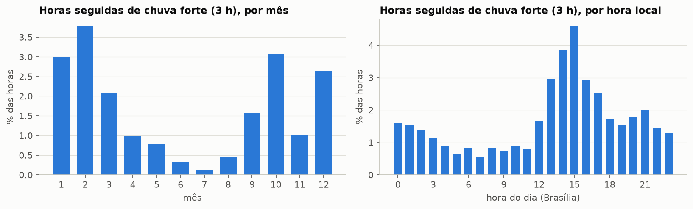
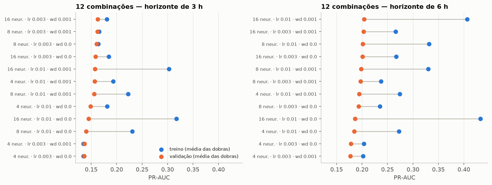
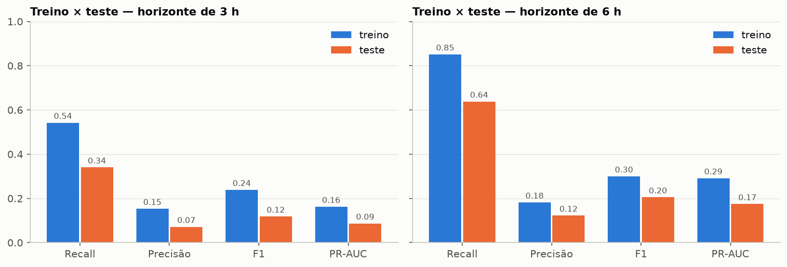
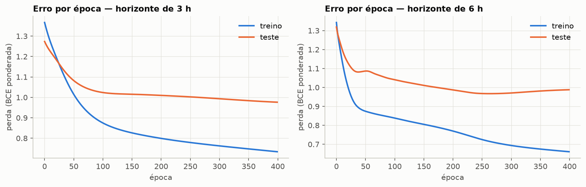

# WaterLine — Relatório de IA & Machine Learning

**FIAP · Global Solution 2026.2 · Previsão de chuva forte para a prevenção de alagamentos**

Notebook executado: [`waterline_chuva_forte.ipynb`](waterline_chuva_forte.ipynb)

## 1. Problema

A WaterLine monitora bocas de lobo com sensores e despacha equipes de limpeza antes que elas transbordem. O sensor mostra a situação atual; falta saber se a chuva está chegando. Este trabalho responde à pergunta: **com o que a estação meteorológica mediu até agora, vai chover forte nas próximas 3 horas? E nas próximas 6?**

É uma classificação binária. "Chuva forte" significa **10 mm ou mais acumulados** no horizonte. A resposta do modelo é enviada ao endpoint `POST /previsoes` da API WaterLine, que eleva a prioridade dos chamados abertos e cria chamados preventivos.

## 2. Dados

Medições **horárias reais** da estação automática **INMET A701 (São Paulo, Mirante de Santana)**, de 01/01/2023 a 31/10/2026: 33.600 horas, baixadas do portal de dados históricos do INMET. Fonte, colunas e formato estão em [`dados/README.md`](dados/README.md). Nenhum dado foi simulado.

**Qualidade.** A radiação fica vazia à noite (46% das horas) e foi preenchida com zero. As outras colunas têm de 0,2% a 2,5% de falhas por ano (a chuva chega a 7,4% em 2023). Essas horas não foram preenchidas: toda linha que depende de uma hora sem medição foi descartada. Sobraram 29.761 horas para o horizonte de 3 h e 29.471 para o de 6 h.

**Desbalanceamento.** Chuva forte é rara: 1,7% das horas em 3 h e 3,7% em 6 h. Ela se concentra de outubro a março e no meio da tarde.



## 3. Preparação

**Atributos (21), todos conhecidos na hora da previsão:** chuva da última hora e acumulados de 3, 6 e 24 h; pressão e sua variação em 3 h; temperatura, ponto de orvalho, diferença entre os dois e umidade, com variações em 3 h; velocidade, rajada e direção do vento; radiação; hora local e mês em seno e cosseno.

**Divisão temporal, sem embaralhar:**

| Conjunto | Período | Horas (3 h) | Positivas (3 h) | Horas (6 h) | Positivas (6 h) |
|---|---|---|---|---|---|
| Treino | 2023 a 2025 | 23.370 | 400 | 23.143 | 854 |
| Teste | jan. a out. de 2026 | 6.388 | 97 | 6.322 | 232 |

Cuidados contra vazamento: as últimas horas de 2025 saem do treino (o alvo delas usa chuva de 2026), e a padronização dos atributos é calculada só com o treino.

## 4. Modelo e justificativa

**Modelo principal: rede neural MLP (perceptron multicamadas) em PyTorch** com uma camada escondida de ativação sigmoide e saída em logit, a arquitetura vista em aula, treinada com Adam e lote completo. Ela foi escolhida porque combina atributos de forma não linear (umidade alta importa mais quando a pressão cai), entrega uma probabilidade, que é o que a API recebe, e é leve o bastante para treinar em segundos em CPU.

**Comparação:** uma Random Forest, referência para dados tabulares, e uma regra ingênua (alertar quando já choveu nas últimas 3 h).

**Desbalanceamento:** a perda `BCEWithLogitsLoss` recebe `pos_weight` igual à razão entre negativos e positivos. A acurácia não é usada; as métricas são recall, precisão, F1 e PR-AUC. O limiar de decisão é escolhido na validação pelo F2, que dá ao recall o dobro do peso da precisão, porque perder uma chuva forte custa mais que um alarme falso.

## 5. Treino com diferentes hiperparâmetros

Foram testadas **12 combinações** de três hiperparâmetros: neurônios (4, 8, 16), taxa de aprendizado (0,01 e 0,003) e `weight_decay` (0 e 0,001). Cada uma passou por validação cruzada temporal (`TimeSeriesSplit`, 3 dobras, intervalo de 24 h) **somente dentro do treino**. O critério foi a PR-AUC média de validação.



- As combinações diferem pouco na validação (0,14 a 0,16 em 3 h; 0,18 a 0,20 em 6 h). O limite vem dos dados, não do tamanho da rede.
- Com 4 neurônios e taxa 0,003 há subajuste: treino e validação iguais e baixos.
- Com 16 neurônios, taxa 0,01 e sem regularização há overfitting: a maior PR-AUC de treino (0,32 e 0,43) com validação entre as piores.
- O `weight_decay` melhorou a validação em 10 de 12 comparações.

**Escolhidas:** 16 neurônios, taxa 0,003, `weight_decay` 0,001 (3 h) e 16 neurônios, taxa 0,01, `weight_decay` 0,001 (6 h).

## 6. Resultados em treino e teste

| Horizonte | Conjunto | Recall | Precisão | F1 | PR-AUC |
|---|---|---|---|---|---|
| 3 h | treino | 0,542 | 0,153 | 0,239 | 0,162 |
| 3 h | **teste** | **0,340** | **0,071** | **0,118** | **0,087** |
| 6 h | treino | 0,851 | 0,182 | 0,300 | 0,291 |
| 6 h | **teste** | **0,638** | **0,122** | **0,205** | **0,174** |





**Overfitting.** Existe e é moderado. Todas as métricas caem do treino para o teste. Em 6 h a perda de teste para de cair perto da época 250 e volta a subir levemente enquanto a de treino continua caindo. Parte da queda tem outra causa: em 3 h o teste (0,09) ficou abaixo até da validação cruzada (0,16), com apenas 97 horas positivas em dez meses, o que torna a medida instável e sugere que 2026 foi um ano mais difícil de prever.

**O modelo tem habilidade real, mas limitada.** A PR-AUC de teste é cerca de 6 vezes a de um modelo sem habilidade em 3 h (0,087 contra 0,015) e quase 5 vezes em 6 h (0,174 contra 0,037).

**Comparações no teste (PR-AUC):**

| Modelo | 3 h | 6 h |
|---|---|---|
| Rede neural MLP (PyTorch) | 0,087 | 0,174 |
| Random Forest | 0,074 | 0,154 |
| Regra: chuva das últimas 3 h | 0,072 | 0,108 |
| Sem habilidade | 0,015 | 0,037 |

- **3 h × 6 h:** o horizonte de 6 h é melhor em todas as métricas. Há mais exemplos positivos, e a janela maior perdoa o erro de horário da tempestade.
- **Rede × Random Forest:** resultados praticamente iguais, com a rede um pouco à frente. A floresta decora bem mais o treino (PR-AUC de treino perto de 0,6). Dois modelos diferentes no mesmo patamar indicam que o limite está nos dados.
- **Regra ingênua:** em 3 h a rede ganha por pouco. Nesse horizonte, quase tudo o que se consegue prever é que a chuva que já começou vai continuar.

Também foram testadas, só na validação, a transformação logarítmica da chuva e variações de 1 hora dos sensores. Não houve ganho, e elas ficaram fora do modelo.

## 7. Conclusão para o cidadão

As métricas acima contam horas. Para quem mora perto de um ponto de alagamento, o que importa são os episódios. Agrupando as horas do teste (janeiro a outubro de 2026):

| | Alerta de 3 h | Alerta de 6 h |
|---|---|---|
| Episódios de chuva forte | 31 | 39 |
| Avisados pelo modelo | 16 (52%) | **34 (87%)** |
| Avisados antes do pico da chuva | 13 | 34 |
| Antecedência mediana até o pico | 2 h | **5 h** |
| Alarmes falsos por mês | 10 | **9** |

**Com o alerta de 6 horas, quase 9 em cada 10 chuvas fortes de 2026 teriam sido avisadas com cerca de 5 horas de antecedência.** O custo são 9 alarmes falsos por mês, pouco mais de dois por semana: de cada quatro alertas, um é seguido de chuva forte.

Esse nível de acerto não serve para pedir que alguém saia de casa. Serve para o uso previsto na WaterLine: colocar a prefeitura em atenção e mandar limpar primeiro as bocas de lobo que os sensores já mostram cheias. Um alarme falso custa uma vistoria preventiva; uma chuva forte não avisada custa um alagamento.

A probabilidade enviada à API é corrigida para desfazer o peso da classe rara. Na média ela bate com a realidade: 4,2% prevista contra 3,7% observada em 6 h.

**Limitações.** Uma única estação não enxerga a tempestade que se forma a quilômetros dali; a precisão é baixa (12%); há overfitting moderado; o teste cobre dez meses de um só ano.

**Próximos passos.** Incluir estações vizinhas e pluviômetros do CEMADEN, radar meteorológico e previsão numérica do tempo, e reavaliar com mais anos de teste.

## 8. Integração com a API

O notebook grava em `modelo/` os pesos, o padronizador e o limiar de cada horizonte. O script `enviar_previsao.py` calcula a previsão e envia ao `POST /previsoes`. Teste feito com a API em execução local:

```
6 h -> enviado {"geradaEm": "2026-01-16T18:00:00Z", "horizonteHoras": 6, "probabilidade": 0.1628, "chuvaForte": true} | HTTP 201
```
